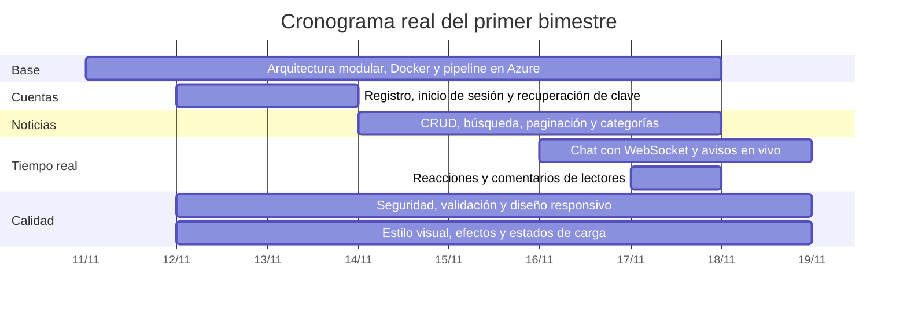
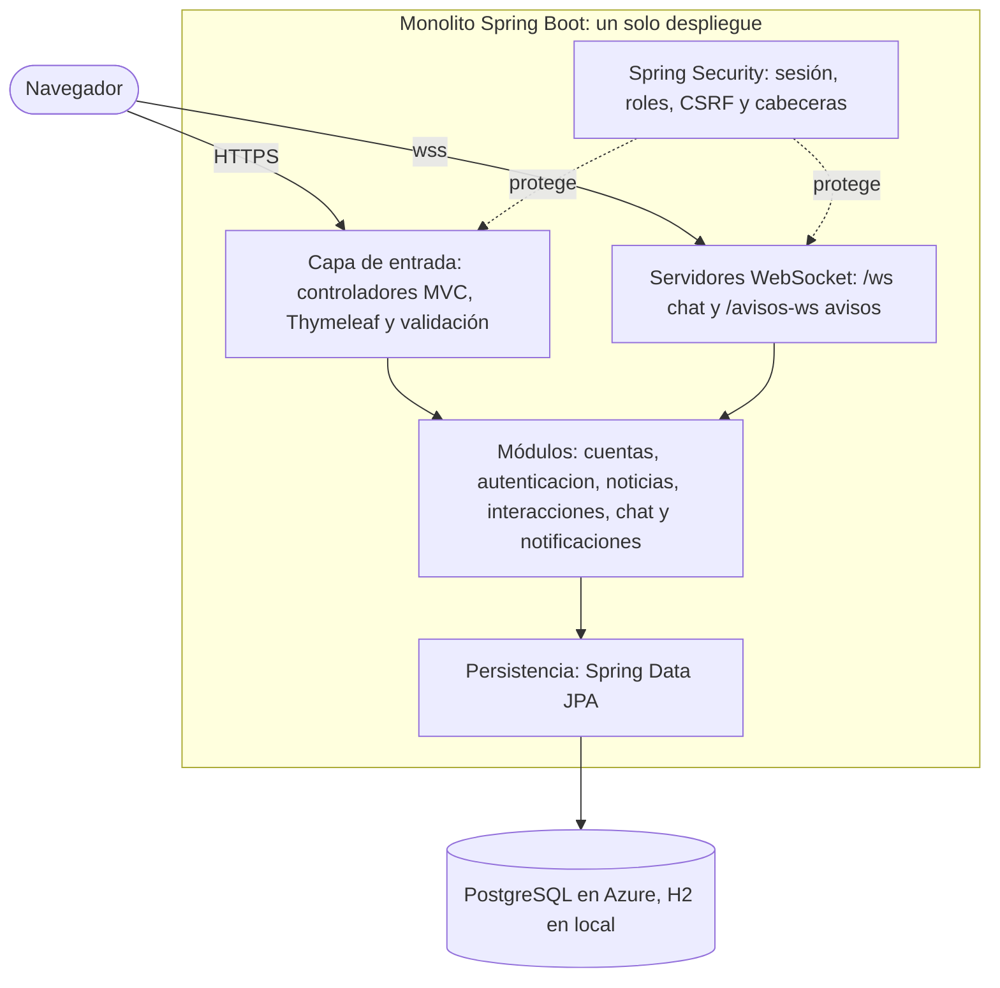
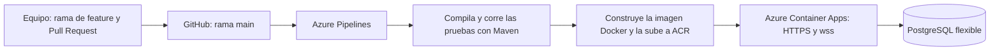
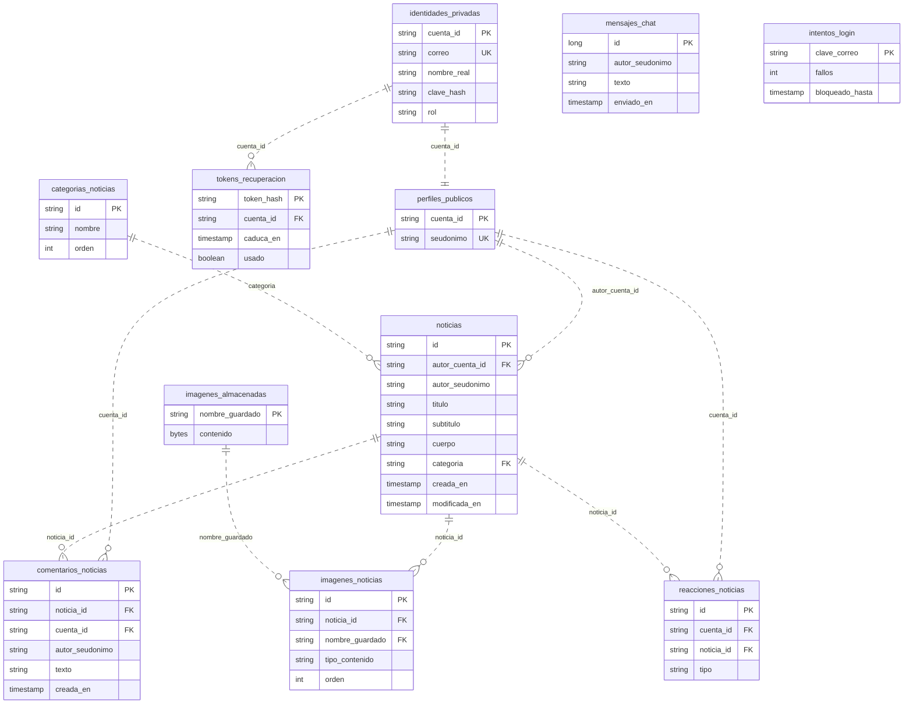

# Entrega del primer bimestre: Periodismo Seguro (aplicación monolítica)

Contenido listo para la presentación y el README, siguiendo la guía del proyecto. Los datos de la aplicación son ficticios.

## 1. El negocio y el problema

**El negocio (PYME).** Periodismo Seguro es un pequeño medio digital independiente que publica noticias escritas por periodistas que no pueden firmar con su nombre real. Funciona como una PYME de medios: pocas personas, ingresos modestos, un portal web y una comunidad de lectores. Su valor es que quien escribe se protege y quien lee se informa sin dejar rastro.

**El problema.** En entornos de censura y amenazas, un periodista puede ser identificado por su nombre, su correo o los datos de su cuenta. Las herramientas actuales cubren una parte (recibir filtraciones, publicar sin cuenta o verificar una foto), pero ninguna junta todo: publicar con seudónimo, mantener la identidad real separada del contenido y dar a los lectores un espacio para informarse y conversar.

**La solución.** Una aplicación web donde el periodista se registra con su correo y su nombre real, pero **publica solo con un seudónimo** generado por el sistema. Los datos reales viven en una tabla privada y nunca aparecen en noticias, comentarios ni chat. Los lectores leen, reaccionan, comentan y conversan en una sala en tiempo real.

**Entidad principal: Noticia** (más de 5 atributos, con validaciones de tipo, formato y longitud):

| Atributo | Tipo y regla |
|---|---|
| `id` | Texto único (UUID) |
| `autorCuentaId` | Referencia a la cuenta del autor (nunca se muestra) |
| `autorSeudonimo` | Seudónimo público del autor |
| `titulo` | Obligatorio, máximo 180 caracteres |
| `subtitulo` | Obligatorio, máximo 300 caracteres |
| `cuerpo` | Obligatorio, máximo 50 000 caracteres, HTML saneado con lista blanca |
| `categoria` | Obligatoria, una de las 9 del catálogo |
| `creadaEn`, `modificadaEn` | Fechas |
| Imágenes | PNG o JPEG, con tamaño máximo, recodificadas antes de guardarse |

Otras entidades relacionadas: cuentas (identidad privada y perfil público), categorías, imágenes, comentarios, reacciones y tokens de recuperación.

## 2. Objetivos

**General.** Desarrollar una aplicación web monolítica y segura que permita a periodistas publicar noticias con seudónimo, sin exponer su identidad real, y a lectores informarse, reaccionar, comentar y conversar en tiempo real.

**Específicos (medibles).**
1. Registrar usuarios con validación en cliente y servidor, y guardar las contraseñas con hash BCrypt y sal.
2. Iniciar sesión contra la base de datos con rutas protegidas por rol, bloqueo tras 5 intentos fallidos y recuperación de clave con token de un solo uso que caduca a los 30 minutos.
3. Ofrecer un CRUD de noticias con listado paginado, búsqueda por texto, filtro por categoría, consulta por identificador y eliminación con confirmación.
4. Implementar un chat con WebSocket propio, autenticado en el handshake, con sala general, usuarios conectados y un aviso adicional en tiempo real de noticias nuevas.
5. Respaldar el sistema con más de 250 pruebas automatizadas que corren en cada cambio.
6. Desplegar la aplicación en Azure con un pipeline que compila, prueba, construye la imagen y publica en cada cambio a la rama principal.

## 3. Cronograma y roles

Fechas tomadas del historial del repositorio.

**Reparto de roles** (asignar el nombre de cada integrante):

| Rol principal | Rol secundario | Responsabilidad | Integrante |
|---|---|---|---|
| Product Owner / Analista | Redacción de casos de abuso | Backlog, historias de usuario y requisitos | (asignar) |
| Arquitecto / Tech Lead | Scrum Master | Arquitectura modular, decisiones y revisión | (asignar) |
| Desarrollo backend | Seguridad | Cuentas, autenticación, noticias y chat | (asignar) |
| Desarrollo frontend | Pruebas de interfaz | Plantillas, estilo, accesibilidad y responsivo | (asignar) |
| QA y seguridad | DevOps | Pruebas, pipeline CI/CD y despliegue en Azure | (asignar) |

**Commits por integrante** (evidencia del repositorio público, rama `main` y ramas de trabajo):

| Autor en Git | Commits |
|---|---|
| Luis Guerrero | 65 |
| MaldonadoGabs (y MaldonadoGabi) | 23 |
| melanysofial | 6 |
| Gabriel Del Valle | 4 |
| dayitaB | 1 |

## 4. Historias de usuario

Las historias están en Azure Boards (`AppWebAv2026-B`). Estado según el código:

| Épica | Historia | Estado |
|---|---|---|
| Registro y autenticación | HU-01 Registro de periodistas | Hecha |
| | HU-02 Identidad real separada del seudónimo | Hecha |
| | HU-03 Inicio de sesión | Hecha |
| | HU-04 Cierre de sesión | Hecha |
| | HU-05 Solicitud de recuperación de clave | Hecha |
| | HU-06 Restablecer clave con token | Hecha |
| Pantalla principal y navegación | HU-07 Menú y navegación | Hecha |
| | HU-08 Protección de rutas y roles | Hecha |
| CRUD de noticias | HU-09 Crear noticia | Hecha |
| | HU-10 Listado paginado | Hecha |
| | HU-11 Búsqueda y filtro | Hecha |
| | HU-12 Consulta por identificador o seudónimo | Hecha |
| | HU-13 Editar noticia propia | Hecha |
| | HU-14 Eliminar con confirmación | Hecha |
| | HU-16 Categorías | Hecha |
| WebSockets | HU-17 Conexión autenticada al chat | Hecha |
| | HU-18 Enviar y recibir en la sala general | Hecha |
| | HU-19 Historial de mensajes persistentes | Hecha (tabla `mensajes_chat`; quien entra recibe los últimos 50) |
| | HU-20 Usuarios conectados | Hecha |
| | HU-21 Notificación en tiempo real de noticias nuevas | Hecha |
| | HU-22 Aviso de mensaje no leído | Pendiente |
| Seguridad y privacidad | HU-25 Cabeceras y sesiones seguras | Hecha |
| | HU-26 No registrar datos que identifiquen al periodista | Hecha |

Extras fuera del tablero: reacciones y comentarios de lectores, recuperación por correo real (Resend), estados de carga, efectos de movimiento y tema claro u oscuro.

## 5. Diagramas de arquitectura

**Arquitectura del monolito** (capas, base de datos y servidores WebSocket):

**Despliegue y CI/CD:**

## 6. Modelo de datos

El esquema se crea con JPA (`ddl-auto=update`). No hay claves foráneas entre módulos a propósito: se refieren por id, para poder separarlos después. Las relaciones punteadas son lógicas.

Decisión de privacidad en el modelo: solo `identidades_privadas` guarda el correo y el nombre real. Ninguna otra tabla los copia; el resto usa el seudónimo.
**Índices** (rendimiento de búsqueda y actualización): noticias por fecha, categoría y autor; comentarios y reacciones por noticia; reacciones por cuenta; imágenes por noticia y tokens por cuenta. El correo y el seudónimo tienen índice único. La búsqueda por texto usa `LIKE` sobre título y cuerpo, que un índice normal no acelera; si el volumen crece, en PostgreSQL se puede añadir un índice de trigramas.

## 7. Repositorio

Repositorio público: https://github.com/MaldonadoGabs/appWebAv2026B-periodismoSeguro

- Trabajo con una rama por historia, commits convencionales (`tipo(módulo): descripción`) y Pull Request hacia `main`.
- Sin credenciales, tokens ni archivos `.env` reales. Las variables están en `.env.example`.
- La entrega se marcará con la etiqueta `v1.0-b1`.

## 8. Pantallas y demostración en vivo

**Pantallas:** inicio con misión, visión, objetivo y feed de noticias con barra de última hora; registro; inicio de sesión; recuperar y restablecer clave; mi panel; mis notas; escribir, editar y eliminar noticia; detalle de noticia con reacciones y comentarios; chat.

**Guion de la demostración:**
1. Abrir el sitio: inicio, barra de última hora y cambio entre tema claro y oscuro.
2. Registrar un periodista y mostrar los errores de validación junto a cada campo.
3. Iniciar sesión (mostrar el estado de carga) y entrar a "Mi panel".
4. Escribir una noticia con imagen y verla en el feed.
5. Buscar por texto, filtrar por categoría y paginar.
6. Editar la noticia y eliminarla con confirmación.
7. Registrar dos lectores en dos ventanas: reaccionar y comentar, y conversar en el chat viendo los usuarios conectados.
8. Publicar una noticia nueva y ver el aviso en vivo en la otra ventana, sin recargar.
9. Recuperar la clave con el enlace de un solo uso.
10. Cerrar sesión y comprobar que las rutas protegidas redirigen al inicio de sesión.

**Seguridad a demostrar:** hash BCrypt en la base de datos, validación en el servidor (enviar un formulario saltándose el navegador), cookie de sesión HttpOnly y WebSocket que rechaza conexiones sin sesión.

## 9. Pruebas realizadas y resultados

`mvn verify` corre **277 pruebas automáticas** en 57 clases, todas en verde, y el pipeline las ejecuta en cada cambio.

| Área | Pruebas | Qué comprueban |
|---|---|---|
| Entrada web | 147 | Validaciones del formulario, CRUD, búsqueda, paginación, seguridad de rutas, estilo, responsivo, estados de carga y efectos |
| Noticias | 38 | Crear, listar, buscar, editar y eliminar, saneamiento y reglas del autor |
| Autenticación | 31 | Inicio de sesión, bloqueo por intentos, sesión, recuperación y restablecimiento de clave |
| Chat | 22 | Conexión autenticada, mensajes, historial guardado en la base, usuarios conectados y escritura |
| Cuentas | 15 | Hash BCrypt, seudónimo único e identidad separada |
| Arquitectura, índices y despliegue | 17 | Reglas entre módulos (ArchUnit), índices de la base, arranque y configuración |
| Interacciones y notificaciones | 7 | Reacciones, comentarios y avisos en tiempo real |

## 10. Uso de herramientas de IA

Se usó Claude (Anthropic), a través de Claude Code, como asistente de programación para generar y revisar código, pruebas, scripts de despliegue, diagramas y documentación. El equipo revisa, prueba y debe poder explicar y modificar todo lo generado durante la defensa.

## 11. Conclusiones y lecciones aprendidas

- El monolito modular con reglas verificadas por ArchUnit permitió repartir el trabajo por historias sin pisarse y deja la aplicación lista para separarla en microservicios en el segundo bimestre.
- La seguridad se diseñó desde el inicio (hash con sal, separación de identidad, saneamiento, CSRF y cabeceras) y se comprobó con pruebas automáticas, no solo a mano.
- Desplegar en Azure enseñó a leer las restricciones del entorno: las regiones permitidas de la suscripción de estudiante y la ausencia de ACR Tasks obligaron a construir la imagen con Docker dentro del pipeline.
- Trabajar con ramas, commits convencionales y Pull Requests hizo visible quién aportó cada cambio y facilitó revisar antes de integrar.
- Pendiente para el segundo bimestre: JWT emitido por un servicio de autenticación, frontend desacoplado, microservicios con una base de datos cada uno y un API Gateway.
